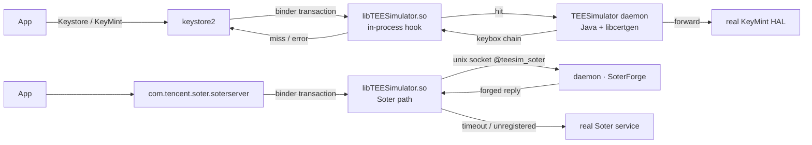

<!-- translated from README.md sha256:6d68553d15c9fc125ee046819d3191578b209c581d91cf3b9a17b68ebd160adb -->
<div align="center">

# TEESimulator-MapleSU

**root 化した Android 端末向けの、単体で動作する Key Attestation および Soter 互換レイヤーです。**

Zygisk 不要 · LSPosed 不要 · 他のモジュールへの依存なし · KernelSU / Magisk / APatch

[](../../releases)
[](../../actions)
[](docs/INSTALL.md)
[](docs/INSTALL.md)
[](LICENSE)

[English](README.md) · [简体中文](README.zh-CN.md) · [繁體中文](README.zh-TW.md) · **日本語** · [Русский](README.ru.md)

[インストール](docs/INSTALL.md) · [ビルド](docs/BUILD.md) · [設定](docs/CONFIG.md) · [アーキテクチャ](docs/ARCHITECTURE.md) · [FAQ](docs/FAQ.md)

</div>

---

## 概要

root 化した Android スマートフォンは、たいてい二つの場面で見破られます。一つは**ハードウェアに基づく Key Attestation** で、アプリが端末に対し、その TEE が本物であることの証明を求めます。もう一つは **Soter** で、アプリがシステムに対し、鍵や生体認証の操作が信頼できる環境で行われたことの確認を求めます。

*TEESimulator-MapleSU* は、すでに正しく動作しているシステムの部分は置き換えずに、この二つのやり取りの整合性を取り戻します。

- Key Attestation の要求には、**ご自身で**用意した keybox から構築した証明書チェーンで keystore2 が応答します。
- Soter では、13 種類の AIDL トランザクションに実機と同じセマンティクスで応答します。uid ごとの ASK、(uid, alias) ごとの AuthKey レジストリ、カウンター、ワンショットセッション、標準のエラーコードを備え、純正 TA と同じ方式である **RSA-PSS** で署名します。
- それ以外はすべて**システム本来の実装に転送**します。

本プロジェクトは [TEESimulator-RS](https://github.com/Enginex0/TEESimulator-RS) の派生版です（TEESimulator-RS 自体は [JingMatrix/TEESimulator](https://github.com/JingMatrix/TEESimulator) を基にしています）。トランザクション層でのインターセプトが有効であることは上流が実証しました。この派生版は、それをより完全で、動作環境の違いにも強い実装に仕上げたものです。

> 開発用の端末では、**Duck Detector、春秋、Demo 1.7** の公開されている検査項目で回帰確認を行っています。以前は「端末の TEE が信頼できない」と報告されていた項目（チェーンの生成、ブート状態、Soter の利用可否）も、導入後は想定どおりに動作します。これは商用のリスク判定エンジンについて何かを約束するものではありません。[免責事項](#免責事項)を参照してください。

---

## この派生版で追加したもの

| | 上流の TEESimulator-RS | 本プロジェクト |
|---|---|---|
| 依存関係 | 注入されるライブラリ | **root のみ。Zygisk、LSPosed、補助モジュールは不要** |
| Soter | 基本的な偽造（固定鍵、セッションなし） | **uid ごとの ASK、(uid, alias) ごとの AuthKey、カウンター、TTL 付きワンショットセッション、標準エラーコード** |
| 署名 | PKCS#1 v1.5 | **RSASSA-PSS（SHA-256 / MGF1 / salt 20 / emBits 2047）** |
| 制御チャネル | binder 登録のみ | **binder を優先し、次にプロセス内の unix ソケット（`@teesim_soter`）を使用**。登録が AMS に依存しない構成 |
| WebUI | 一部のみ | **デュアルバックエンド**：ネイティブ `.so` の HTTP または `ksu.exec` |
| 信頼性 | 基本的 | 時間制限付きの注入確認、単一インスタンスの保護、旧 id の移行、起動後の target 再読み込み |
| 可観測性 | ログ | **`ksu_status` が起動の全ステップを記録** |

---

## 仕組み



ルールは一つだけです。**変更は最小限にとどめ、それ以外はすべて転送する**。失敗したときの経路はすべて本来の実装にフォールバックするため、シミュレーションが壊れても機能が働かなくなるだけで、端末の keystore を停止させることはありません。

設計上の判断のうち、特に重要なものが三つあります。

1. **鍵は ID ごとに分けます。** ASK は uid ごとに生成して永続化し、AuthKey は (uid, alias) ごとに生成します。これはアプリごとに独自の ASK を持つ実機と同じ構成であり、単一の鍵ペアを共有した場合に生じるフィンガープリンティングも防げます。
2. **登録を AMS に依存させません。** 単体で起動した `app_process` にはプロセスレコードがないため、`bindService` は拒否されます。注入したライブラリが saterserver 内で抽象 unix ソケットを待ち受け、デーモンがそこへ接続するので、経路から AMS が完全になくなります。
3. **失敗したら転送します。** 2 秒のソケットタイムアウト、未登録のコード、`-1` の応答のいずれでも、トランザクションは本来のサービスに戻されます。

---

## 機能

| 項目 | 内容 |
|---|---|
| Key Attestation | keystore2 の鍵・構成証明トランザクションをインターセプトし、keybox から完全なチェーンを構築 |
| アプリごとの適用範囲 | `target.txt`。`pkg`、`pkg!`、`!pkg`、`pkg?`、`?pkg` のどの書き方も使用可能 |
| Soter | 13 種類のトランザクション、レジストリ、セッション、エラーコード、PSS 署名 |
| Soter の適用範囲 | アプリ単位の許可リスト。WebUI で編集可能 |
| 証明書チェーン | デフォルトでオフ。有効にすると Soter の blob に keybox のチェーンを格納 |
| keybox の自動更新 | デフォルトでオン。アトミックに置き換え、失敗しても使用中のファイルは上書きせず、5 分後に再試行。ご自身で配置した keybox を置き換えるのは **Update now** のみで、その前にバックアップを作成 |
| システム情報の偽装 | ブートローダーの状態とセキュリティパッチの日付 |
| 互換性チェック | インストール時に実行し、結果をインストールログに出力。インストールを止めることは一切なし。他のモジュールは名前ではなく、実際に何を変更しているかで判断 |
| WebUI | バージョン、互換性チェック、SOTER、証明書、keybox、偽装、適用範囲。カエデの葉をモチーフにした季節テーマ 4 種（春・夏・秋・冬）、それぞれライトとダーク。翻訳カタログによる中国語と英語の表示 |
| 可観測性 | `ksu_status` が起動の各ステップを記録 |

---

## 動作要件

- Android 10 以降（開発と回帰確認は Android 17 まで）
- 64 ビット端末（arm64-v8a）
- root：KernelSU、Magisk、または APatch
- **法的に使用が認められた入手元からの** `keybox.xml`。このリポジトリには鍵素材は含まれていません

---

## インストール

1. [Releases](../../releases) から zip をダウンロードします。
2. root マネージャーでインストールし、再起動します。
3. keybox を配置します。

   ```bash
   su -c 'cp /sdcard/Download/keybox.xml /data/adb/tricky_store/keybox.xml'
   su -c 'chmod 644 /data/adb/tricky_store/keybox.xml'
   ```

4. 再起動して WebUI を確認します。keybox がなければ、インターセプターは何もしません。設定に誤りがあっても、モジュールが働かなくなるだけで危険はありません。

モジュール id は上流と同じ `tricky_store` なので、既存のインストールを置き換えられます。旧 id `teesimulator-rs` からのアップグレードは自動的に移行されます。アップグレード、アンインストール、ロールバックについては [docs/INSTALL.md](docs/INSTALL.md) を参照してください。

---

## 設定

すべて `/data/adb/tricky_store/` の下にあります。

| ファイル | 用途 |
|---|---|
| `keybox.xml` | 証明書チェーンの元データ（ご自身で用意したもの） |
| `keybox_update.conf` | 自動更新：オン／オフ、更新元、間隔、再試行の状態 |
| `target.txt` | インターセプトするアプリ |
| `security_patch.txt` | 端末に合わせるか、日付を固定するか |
| `soter_scope.conf` | Soter の適用範囲（ファイルがなければ全アプリ） |
| `soter_certs` | 証明書チェーンのスイッチ（デフォルトでオフ） |
| `soter_socket_off` | ソケットチャネルを無効にし、binder にフォールバック |
| `ksu_status` | 起動の各ステップの結果 |

各項目の詳しい説明は [docs/CONFIG.md](docs/CONFIG.md) にあります。

---

## 動作確認

```bash
# module state
su -c 'cat /data/adb/tricky_store/ksu_status'

# did the injection actually land?
su -c 'pid=$(pidof keystore2); grep -c libTEESimulator /proc/$pid/maps'

# which Soter channel is in use?
su -c 'cat /data/adb/tricky_store/soter_route'
```

| 値 | 意味 |
|---|---|
| `core=ok` / `daemon=<pid>` | デーモンが動作中 |
| `inject=ok` | 注入に成功し、確認済み |
| `soter_route=socket` | Soter が AMS に依存しないチャネルを使用中 |
| `conflict=<id>` | 別の TEE モジュールを検出し、このモジュールは動作を譲った状態 |

公開されている検出アプリの検査項目に関する回帰確認のメモは [docs/FAQ.md](docs/FAQ.md#检测项) にあります。

---

## ソースからのビルド

```bash
# JDK 21 + Android NDK r26 + Python 3.11+
cd dex && python3 make_p16.py a b d e f g s s4 m p        # -> classes_p16.dex
cd ../native && "$ANDROID_NDK/ndk-build" NDK_PROJECT_PATH=. # -> libTEESimulator.so
MAPLESU_TEE_DEX=dex/classes_p16.dex python3 tools/package_teesimulator_bundle.py
```

ビルドは再現可能です。同じソースから 2 回ビルドすると、同一のハッシュになります。[docs/BUILD.md](docs/BUILD.md) を参照してください。

---

## ディレクトリ構成

| パス | 内容 |
|---|---|
| `dex/` | smali パッチツリーと Java ソース（`mpl/*`）：トランザクション処理と証明書生成 |
| `native/` | `libTEESimulator.so`：binder フックと Soter のソケットチャネル |
| `module/` | `hide_bootloader.sh`、`core/webui.sh`、`core/compat.sh`、`webroot/`、`sepolicy.rule` |
| `tools/` | パッケージング、検証、診断用のスクリプト |
| `docs/` | インストール、ビルド、設定、アーキテクチャ、FAQ |
| `scripts/` | ビルドのエントリーポイント |

---

## ドキュメント

| ドキュメント | 内容 |
|---|---|
| [INSTALL](docs/INSTALL.md) | インストール、アップグレード、アンインストール、ロールバック、インストール時のつまずきやすい点 |
| [BUILD](docs/BUILD.md) | dex、ネイティブライブラリ、パッケージング、検証 |
| [CONFIG](docs/CONFIG.md) | すべての設定項目 |
| [ARCHITECTURE](docs/ARCHITECTURE.md) | インターセプトの経路、ソケットプロトコル、証明書生成 |
| [FAQ](docs/FAQ.md) | トラブルシューティングと検出アプリに関するメモ |
| [TRANSLATING](docs/TRANSLATING.md) | WebUI と README の翻訳 |

---

## 謝辞

- 上流：[Enginex0/TEESimulator-RS](https://github.com/Enginex0/TEESimulator-RS) と [JingMatrix/TEESimulator](https://github.com/JingMatrix/TEESimulator)。どちらも GPL-3.0 です。
- Soter のセマンティクス、検出アプリでの回帰確認、デバッグの方向性について力を貸してくださった **[知秋 (947409161)](https://github.com/947409161)** に、特に感謝します。
- 関連する参考実装：公開されている設計を、本プロジェクトの設計の参考にしました。コードは流用していません。

完全な一覧は [CREDITS.md](CREDITS.md) にあります。

## ライセンス

GPL-3.0 です。上流部分の著作権は Enginex0 と JingMatrix に帰属します。[NOTICE](NOTICE) を参照してください。

## 免責事項

本プロジェクトは、Android Key Attestation と Soter の**インターフェース互換性**に関する研究用の実装です。ご自身が所有する端末で、システムのセキュリティ機構がどのように動作するかを調べることを目的としています。

- **特定のアプリを対象としておらず**、特定のアプリ向けの調整も含まず、いかなる種類の認証・認可の回避も提供しません。
- **鍵素材は一切含みません**。合法的に使用できる証明書の入手元を、ご自身で用意する必要があります。
- 権限のない端末での使用、詐欺、その他あらゆる違法な目的での使用は**禁止**します。
- 端末のセキュリティ機構を改変することは、地域によっては現地の法律や利用規約に違反する場合があります。法令等の遵守はご自身の責任で行ってください。
- 使用によって生じたアカウントへのリスク管理上の措置、端末の故障、データの消失、法的な結果について、作者は一切の責任を負いません。

GPL-3.0 の下で配布しており、いかなる保証もありません。
