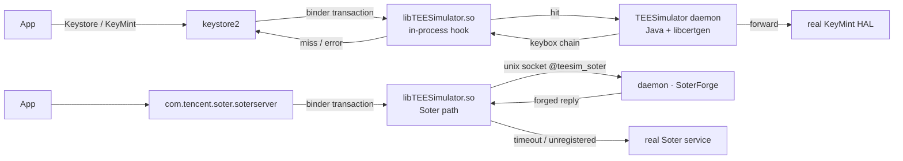

<div align="center">

# TEESimulator-MapleSU

**A self-contained Key Attestation and Soter compatibility layer for rooted Android devices.**

No Zygisk · No LSPosed · No dependency on any other module · KernelSU / Magisk / APatch

[](../../releases)
[](../../actions)
[](docs/INSTALL.md)
[](docs/INSTALL.md)
[](LICENSE)

[Install](docs/INSTALL.md) · [Build](docs/BUILD.md) · [Configuration](docs/CONFIG.md) · [Architecture](docs/ARCHITECTURE.md) · [FAQ](docs/FAQ.md)

</div>

---

## What this is

A rooted Android phone usually gives itself away in two places: **hardware-backed Key
Attestation**, where an app asks the device to prove that its TEE is genuine, and
**Soter**, where an app asks the system to confirm that a key or biometric operation
came from a trusted environment.

*TEESimulator-MapleSU* makes both conversations internally consistent again, without
replacing the parts of the system that already work:

- for attestation requests, keystore2 answers with a certificate chain built from the
  keybox **you** supply;
- for Soter, the 13 AIDL transactions are answered with the same semantics a real
  device uses — a per-uid ASK, a per-(uid, alias) AuthKey registry, counters, one-shot
  sessions, and standard error codes — signed with **RSA-PSS**, the scheme the stock TA
  uses;
- everything else is **forwarded to the real system implementation**.

The project is a branch of [TEESimulator-RS](https://github.com/Enginex0/TEESimulator-RS)
(itself built on [JingMatrix/TEESimulator](https://github.com/JingMatrix/TEESimulator)).
Upstream proved that intercepting the transaction layer works; this branch turns that
into a more complete and more environment-tolerant implementation.

> On our development devices we regress the public checks of **Duck Detector, 春秋 and
> Demo 1.7**. Items that previously reported "device TEE untrusted" — chain generation,
> boot state, Soter availability — behave as expected afterwards. This is not a promise
> about any commercial risk engine; see the [disclaimer](#disclaimer).

---

## What this branch adds

| | Upstream TEESimulator-RS | This project |
|---|---|---|
| Dependencies | injected library | **root only — no Zygisk, no LSPosed, no helper module** |
| Soter | basic forging (fixed keys, no sessions) | **per-uid ASK, per-(uid, alias) AuthKey, counters, one-shot sessions with TTL, standard error codes** |
| Signature | PKCS#1 v1.5 | **RSASSA-PSS (SHA-256 / MGF1 / salt 20 / emBits 2047)** |
| Control channel | binder registration only | **binder first, then an in-process unix socket (`@teesim_soter`)** so registration no longer depends on AMS |
| WebUI | partial | **dual backend**: native `.so` HTTP or `ksu.exec` |
| Reliability | basic | bounded injection probe, single-instance guard, legacy-id migration, post-boot target refresh |
| Observability | logs | **`ksu_status` records every boot step** |

---

## How it works



There is one rule: **change as little as possible, forward everything else**. Every
failure path falls back to the real implementation, so a broken simulation can make a
feature inert but cannot take the device's keystore down.

Three design decisions matter more than the rest:

1. **Keys are per identity.** The ASK is generated per uid and persisted; the AuthKey is
   generated per (uid, alias). This mirrors a real device, where every app has its own
   ASK, and it avoids the fingerprinting that a single shared key pair would create.
2. **Registration must not depend on AMS.** A bare `app_process` has no process record,
   so `bindService` is refused. The injected library listens on an abstract unix socket
   inside saterserver and the daemon connects to it, which removes AMS from the path
   entirely.
3. **Failure means forward.** A socket timeout of two seconds, an unregistered code, or
   a `-1` reply all hand the transaction back to the real service.

---

## Features

| Area | Detail |
|---|---|
| Key Attestation | intercepts keystore2 key/attestation transactions, builds a full chain from the keybox |
| Per-app scope | `target.txt`; `pkg`, `pkg!`, `!pkg`, `pkg?` and `?pkg` are all accepted |
| Soter | 13 transactions, registry, sessions, error codes, PSS signatures |
| Soter scope | per-app allowlist, editable in the WebUI |
| Certificate chain | off by default; when enabled, Soter blobs carry the keybox chain |
| Keybox auto-update | on by default, atomic replace, a failed attempt never overwrites the live file and is retried after five minutes; a keybox you placed yourself is only replaced by **Update now**, which backs it up first |
| System spoofing | bootloader state and security patch date |
| WebUI | version, SOTER, certificates, keybox, spoofing, scope |
| Observability | `ksu_status` records each boot step |

---

## Requirements

- Android 10 or newer (development and regression coverage up to Android 17)
- 64-bit device (arm64-v8a)
- Root: KernelSU, Magisk or APatch
- A `keybox.xml` **from a source you are legally allowed to use**; this repository ships
  no key material

---

## Installation

1. Download the zip from [Releases](../../releases).
2. Install it with your root manager and reboot.
3. Place your keybox:

   ```bash
   su -c 'cp /sdcard/Download/keybox.xml /data/adb/tricky_store/keybox.xml'
   su -c 'chmod 644 /data/adb/tricky_store/keybox.xml'
   ```

4. Reboot and check the WebUI. Without a keybox the interceptor stays a no-op; a
   misconfigured module is inert rather than hazardous.

The module id is `tricky_store`, matching upstream, so it can replace an existing
installation; upgrades from the legacy `teesimulator-rs` id are migrated automatically.
See [docs/INSTALL.md](docs/INSTALL.md) for upgrade, uninstall and rollback.

---

## Configuration

Everything lives under `/data/adb/tricky_store/`.

| File | Purpose |
|---|---|
| `keybox.xml` | certificate chain source (yours) |
| `keybox_update.conf` | auto-update: switch, channel, interval, retry state |
| `target.txt` | which apps are intercepted |
| `security_patch.txt` | follow the device or pin a date |
| `soter_scope.conf` | Soter scope (absent = all apps) |
| `soter_certs` | certificate chain switch (off by default) |
| `soter_socket_off` | disable the socket channel, fall back to binder |
| `ksu_status` | per-step boot result |

Field-by-field documentation is in [docs/CONFIG.md](docs/CONFIG.md).

---

## Verification

```bash
# module state
su -c 'cat /data/adb/tricky_store/ksu_status'

# did the injection actually land?
su -c 'pid=$(pidof keystore2); grep -c libTEESimulator /proc/$pid/maps'

# which Soter channel is in use?
su -c 'cat /data/adb/tricky_store/soter_route'
```

| Value | Meaning |
|---|---|
| `core=ok` / `daemon=<pid>` | the daemon is running |
| `inject=ok` | injection succeeded and was verified |
| `soter_route=socket` | Soter uses the AMS-independent channel |
| `conflict=<id>` | another TEE module was detected and this one stepped aside |

Regression notes for public detector checks are in [docs/FAQ.md](docs/FAQ.md#detector-checks).

---

## Building from source

```bash
# JDK 21 + Android NDK r26 + Python 3.11+
cd dex && python3 make_p16.py a b d e f g s s4 m p        # -> classes_p16.dex
cd ../native && "$ANDROID_NDK/ndk-build" NDK_PROJECT_PATH=. # -> libTEESimulator.so
MAPLESU_TEE_DEX=dex/classes_p16.dex python3 tools/package_teesimulator_bundle.py
```

The build is reproducible: two builds from the same sources produce identical hashes.
See [docs/BUILD.md](docs/BUILD.md).

---

## Project layout

| Path | What it is |
|---|---|
| `dex/` | smali patch tree and Java sources (`mpl/*`): transaction handling and certificate generation |
| `native/` | `libTEESimulator.so`: binder hooks and the Soter socket channel |
| `module/` | `service.sh`, `core/webui.sh`, `core/compat.sh`, `webroot/`, `sepolicy.rule` |
| `tools/` | packaging, verification and diagnostic scripts |
| `docs/` | installation, build, configuration, architecture, FAQ |
| `scripts/` | build entry point |

---

## Documentation

| Document | Content |
|---|---|
| [INSTALL](docs/INSTALL.md) | install, upgrade, uninstall, rollback, installation pitfalls |
| [BUILD](docs/BUILD.md) | dex, native library, packaging, verification |
| [CONFIG](docs/CONFIG.md) | every configuration field |
| [ARCHITECTURE](docs/ARCHITECTURE.md) | interception paths, socket protocol, certificate generation |
| [FAQ](docs/FAQ.md) | troubleshooting and detector notes |

---

## Credits

- Upstream: [Enginex0/TEESimulator-RS](https://github.com/Enginex0/TEESimulator-RS) and
  [JingMatrix/TEESimulator](https://github.com/JingMatrix/TEESimulator), both GPL-3.0.
- Special thanks to **[知秋 (947409161)](https://github.com/947409161)** for help with
  Soter semantics, detector regressions and debugging direction.
- Related reference implementations: their public designs informed ours; no code is
  reused.

The full list is in [CREDITS.md](CREDITS.md).

## License

GPL-3.0. Upstream copyright belongs to Enginex0 and JingMatrix; see [NOTICE](NOTICE).

## Disclaimer

This project is a research implementation of Android Key Attestation and Soter
**interface compatibility**, intended for studying how system security mechanisms behave
on devices you own.

- It targets **no specific application**, ships no application-specific adaptation, and
  provides no authentication or authorization bypass of any kind;
- It ships **no key material**; you must supply a certificate source you may legally use;
- Use on unauthorized devices, for fraud, or for any illegal purpose is **prohibited**;
- Modifying device security mechanisms may violate local law or terms of service in some
  jurisdictions; you are responsible for compliance;
- The authors accept no liability for account risk controls, device malfunction, data
  loss, or legal consequences arising from use.

Distributed under GPL-3.0, without warranty of any kind.
