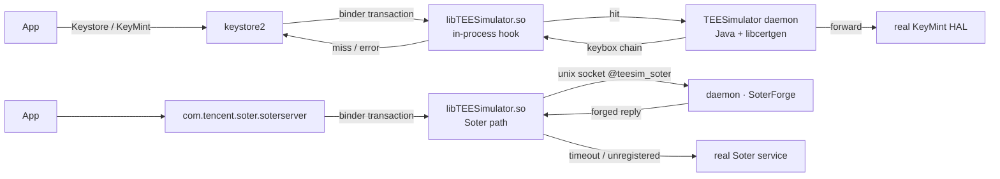

<!-- translated from README.md sha256:6d68553d15c9fc125ee046819d3191578b209c581d91cf3b9a17b68ebd160adb -->
<div align="center">

# TEESimulator-MapleSU

**Самодостаточный слой совместимости Key Attestation и Soter для Android-устройств с root.**

Без Zygisk · Без LSPosed · Без зависимости от других модулей · KernelSU / Magisk / APatch

[](../../releases)
[](../../actions)
[](docs/INSTALL.md)
[](docs/INSTALL.md)
[](LICENSE)

[English](README.md) · [简体中文](README.zh-CN.md) · [繁體中文](README.zh-TW.md) · [日本語](README.ja.md) · **Русский**

[Установка](docs/INSTALL.md) · [Сборка](docs/BUILD.md) · [Настройка](docs/CONFIG.md) · [Архитектура](docs/ARCHITECTURE.md) · [FAQ](docs/FAQ.md)

</div>

---

## Что это такое

Android-телефон с root обычно выдаёт себя в двух местах: в **аппаратной Key
Attestation**, где приложение просит устройство доказать подлинность своего TEE, и в
**Soter**, где приложение просит систему подтвердить, что операция с ключом или
биометрией выполнена в доверенной среде.

*TEESimulator-MapleSU* снова делает оба этих диалога внутренне согласованными и при
этом не заменяет те части системы, которые и так работают:

- на запросы Key Attestation keystore2 отвечает цепочкой сертификатов, построенной из
  keybox, который предоставляете **вы**;
- на 13 транзакций AIDL в Soter даются ответы с той же семантикой, что и на настоящем
  устройстве: ASK для каждого uid, реестр AuthKey для каждой пары (uid, alias),
  счётчики, одноразовые сессии и стандартные коды ошибок; ответы подписываются по схеме
  **RSA-PSS**, которую использует штатный TA;
- всё остальное **передаётся настоящей системной реализации**.

Проект — ответвление [TEESimulator-RS](https://github.com/Enginex0/TEESimulator-RS)
(который, в свою очередь, основан на [JingMatrix/TEESimulator](https://github.com/JingMatrix/TEESimulator)).
Исходный проект доказал, что перехват на уровне транзакций работает; это ответвление
превращает его в более полную реализацию, более терпимую к особенностям окружения.

> На наших устройствах для разработки мы прогоняем регрессионные проверки по открытым
> тестам **Duck Detector, 春秋 и Demo 1.7**. Пункты, по которым раньше выдавалось
> «TEE устройства не заслуживает доверия», — генерация цепочки, состояние загрузки,
> доступность Soter — после этого ведут себя как положено. Это не обещание в отношении
> какой-либо коммерческой системы оценки рисков; см.
> [отказ от ответственности](#отказ-от-ответственности).

---

## Что добавляет это ответвление

| | Исходный TEESimulator-RS | Этот проект |
|---|---|---|
| Зависимости | внедряемая библиотека | **только root — без Zygisk, без LSPosed, без вспомогательного модуля** |
| Soter | базовая подделка (фиксированные ключи, без сессий) | **ASK для каждого uid, AuthKey для каждой пары (uid, alias), счётчики, одноразовые сессии с TTL, стандартные коды ошибок** |
| Подпись | PKCS#1 v1.5 | **RSASSA-PSS (SHA-256 / MGF1 / salt 20 / emBits 2047)** |
| Канал управления | только регистрация через binder | **сначала binder, затем unix-сокет внутри процесса (`@teesim_soter`)**, поэтому регистрация больше не зависит от AMS |
| WebUI | частично | **два бэкенда**: нативный HTTP в `.so` или `ksu.exec` |
| Надёжность | базовая | ограниченная по времени проверка внедрения, защита от второго экземпляра, перенос со старого id, обновление target после загрузки |
| Наблюдаемость | логи | **`ksu_status` записывает каждый шаг загрузки** |

---

## Как это работает



Правило одно: **менять как можно меньше, всё остальное передавать дальше**. Каждый путь
отказа ведёт обратно к настоящей реализации, поэтому сломанная имитация может отключить
функцию, но не может уронить keystore устройства.

Три проектных решения важнее остальных:

1. **Для каждого идентификатора — свои ключи.** ASK создаётся для каждого uid и сохраняется;
   AuthKey создаётся для каждой пары (uid, alias). Так устроено и настоящее
   устройство, где у каждого приложения свой ASK, и это исключает фингерпринтинг,
   который сделала бы возможным одна общая пара ключей.
2. **Регистрация не должна зависеть от AMS.** У голого `app_process` нет записи
   процесса, поэтому вызов `bindService` отклоняется. Внедрённая библиотека слушает
   абстрактный unix-сокет внутри saterserver, а демон подключается к нему, и AMS
   полностью исчезает из этого пути.
3. **Сбой означает передачу дальше.** Тайм-аут сокета в две секунды,
   незарегистрированный код или ответ `-1` возвращают транзакцию настоящему сервису.

---

## Возможности

| Область | Подробности |
|---|---|
| Key Attestation | перехватывает транзакции keystore2 с ключами и аттестацией, строит полную цепочку из keybox |
| Область действия по приложениям | `target.txt`; принимаются все варианты: `pkg`, `pkg!`, `!pkg`, `pkg?` и `?pkg` |
| Soter | 13 транзакций, реестр, сессии, коды ошибок, подписи PSS |
| Область действия Soter | белый список приложений, редактируется в WebUI |
| Цепочка сертификатов | по умолчанию выключена; если её включить, blob-данные Soter несут цепочку из keybox |
| Автообновление keybox | включено по умолчанию, атомарная замена; неудачная попытка никогда не перезаписывает рабочий файл и повторяется через пять минут; keybox, который вы положили сами, заменяет только **Update now**, предварительно сделав резервную копию |
| Подмена системных данных | состояние загрузчика и дата патча безопасности |
| Проверка совместимости | запускается при установке и пишет результат в журнал установки, никогда её не блокируя; другие модули оцениваются по тому, что они на самом деле меняют, а не по имени |
| WebUI | версия, проверка совместимости, SOTER, сертификаты, keybox, подмена, область действия; четыре сезонные темы с кленовым листом (весна, лето, осень, зима), каждая в светлом и тёмном варианте; тексты на китайском и английском из каталога переводов |
| Наблюдаемость | `ksu_status` записывает каждый шаг загрузки |

---

## Требования

- Android 10 или новее (разработка и регрессионные проверки — вплоть до Android 17)
- 64-битное устройство (arm64-v8a)
- Root: KernelSU, Magisk или APatch
- `keybox.xml` **из источника, который вы вправе законно использовать**; в этом
  репозитории нет ключевого материала

---

## Установка

1. Скачайте zip со страницы [Releases](../../releases).
2. Установите его через root-менеджер и перезагрузите устройство.
3. Положите свой keybox:

   ```bash
   su -c 'cp /sdcard/Download/keybox.xml /data/adb/tricky_store/keybox.xml'
   su -c 'chmod 644 /data/adb/tricky_store/keybox.xml'
   ```

4. Перезагрузитесь и проверьте WebUI. Без keybox перехватчик ничего не делает; неверно
   настроенный модуль просто бездействует и не представляет опасности.

Идентификатор модуля — `tricky_store`, как в исходном проекте, поэтому модуль может
заменить существующую установку; при обновлении со старого id `teesimulator-rs`
перенос выполняется автоматически. Обновление, удаление и откат описаны в
[docs/INSTALL.md](docs/INSTALL.md).

---

## Настройка

Всё хранится в `/data/adb/tricky_store/`.

| Файл | Назначение |
|---|---|
| `keybox.xml` | источник цепочки сертификатов (ваш) |
| `keybox_update.conf` | автообновление: переключатель, источник, интервал, состояние повторов |
| `target.txt` | какие приложения перехватываются |
| `security_patch.txt` | следовать устройству или зафиксировать дату |
| `soter_scope.conf` | область действия Soter (нет файла — все приложения) |
| `soter_certs` | переключатель цепочки сертификатов (по умолчанию выключен) |
| `soter_socket_off` | отключить канал через сокет и вернуться к binder |
| `ksu_status` | результат каждого шага загрузки |

Описание каждого параметра — в [docs/CONFIG.md](docs/CONFIG.md).

---

## Проверка

```bash
# module state
su -c 'cat /data/adb/tricky_store/ksu_status'

# did the injection actually land?
su -c 'pid=$(pidof keystore2); grep -c libTEESimulator /proc/$pid/maps'

# which Soter channel is in use?
su -c 'cat /data/adb/tricky_store/soter_route'
```

| Значение | Смысл |
|---|---|
| `core=ok` / `daemon=<pid>` | демон запущен |
| `inject=ok` | внедрение прошло успешно и подтверждено |
| `soter_route=socket` | Soter использует канал, не зависящий от AMS |
| `conflict=<id>` | обнаружен другой TEE-модуль, и этот модуль уступил ему место |

Заметки о регрессионных проверках на публичных детекторах — в
[docs/FAQ.md](docs/FAQ.md#检测项).

---

## Сборка из исходников

```bash
# JDK 21 + Android NDK r26 + Python 3.11+
cd dex && python3 make_p16.py a b d e f g s s4 m p        # -> classes_p16.dex
cd ../native && "$ANDROID_NDK/ndk-build" NDK_PROJECT_PATH=. # -> libTEESimulator.so
MAPLESU_TEE_DEX=dex/classes_p16.dex python3 tools/package_teesimulator_bundle.py
```

Сборка воспроизводима: две сборки из одних и тех же исходников дают одинаковые хеши.
См. [docs/BUILD.md](docs/BUILD.md).

---

## Структура проекта

| Путь | Что это |
|---|---|
| `dex/` | дерево патчей smali и исходники Java (`mpl/*`): обработка транзакций и генерация сертификатов |
| `native/` | `libTEESimulator.so`: хуки binder и канал Soter через сокет |
| `module/` | `hide_bootloader.sh`, `core/webui.sh`, `core/compat.sh`, `webroot/`, `sepolicy.rule` |
| `tools/` | скрипты упаковки, проверки и диагностики |
| `docs/` | установка, сборка, настройка, архитектура, FAQ |
| `scripts/` | точка входа сборки |

---

## Документация

| Документ | Содержание |
|---|---|
| [INSTALL](docs/INSTALL.md) | установка, обновление, удаление, откат, подводные камни при установке |
| [BUILD](docs/BUILD.md) | dex, нативная библиотека, упаковка, проверка |
| [CONFIG](docs/CONFIG.md) | все параметры конфигурации |
| [ARCHITECTURE](docs/ARCHITECTURE.md) | пути перехвата, протокол сокета, генерация сертификатов |
| [FAQ](docs/FAQ.md) | устранение неполадок и заметки о детекторах |
| [TRANSLATING](docs/TRANSLATING.md) | перевод WebUI и README |

---

## Благодарности

- Исходные проекты: [Enginex0/TEESimulator-RS](https://github.com/Enginex0/TEESimulator-RS) и
  [JingMatrix/TEESimulator](https://github.com/JingMatrix/TEESimulator), оба под GPL-3.0.
- Особая благодарность **[知秋 (947409161)](https://github.com/947409161)** за помощь с
  семантикой Soter, регрессионными проверками на детекторах и направлением отладки.
- Родственные эталонные реализации: их открытые решения повлияли на наши; код не
  заимствован.

Полный список — в [CREDITS.md](CREDITS.md).

## Лицензия

GPL-3.0. Авторские права на исходные проекты принадлежат Enginex0 и JingMatrix; см.
[NOTICE](NOTICE).

## Отказ от ответственности

Этот проект — исследовательская реализация **совместимости интерфейсов** Android Key
Attestation и Soter, предназначенная для изучения того, как механизмы безопасности
системы ведут себя на принадлежащих вам устройствах.

- Он **не нацелен ни на какое конкретное приложение**, не содержит адаптаций под
  отдельные приложения и не обеспечивает никакого обхода аутентификации или
  авторизации;
- Он **не содержит ключевого материала**; источник сертификатов, который вы вправе
  законно использовать, нужно предоставить самостоятельно;
- Использование на устройствах без разрешения, для мошенничества или в любых
  незаконных целях **запрещено**;
- В некоторых юрисдикциях изменение механизмов безопасности устройства может нарушать
  местное законодательство или условия использования сервисов; ответственность за
  соблюдение требований лежит на вас;
- Авторы не несут ответственности за ограничения аккаунтов системами контроля рисков,
  неисправность устройств, потерю данных или правовые последствия, возникшие в
  результате использования.

Распространяется на условиях GPL-3.0 без каких-либо гарантий.
