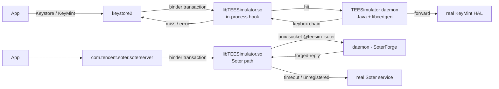

<!-- translated from README.md sha256:6d68553d15c9fc125ee046819d3191578b209c581d91cf3b9a17b68ebd160adb -->
<div align="center">

# TEESimulator-MapleSU

**一个独立的 Key Attestation 与 Soter 兼容层，适用于已 root 的 Android 设备。**

无需 Zygisk · 无需 LSPosed · 不依赖任何其他模块 · KernelSU / Magisk / APatch

[](../../releases)
[](../../actions)
[](docs/INSTALL.md)
[](docs/INSTALL.md)
[](LICENSE)

[English](README.md) · **简体中文** · [繁體中文](README.zh-TW.md) · [日本語](README.ja.md) · [Русский](README.ru.md)

[安装](docs/INSTALL.md) · [构建](docs/BUILD.md) · [配置](docs/CONFIG.md) · [架构](docs/ARCHITECTURE.md) · [FAQ](docs/FAQ.md)

</div>

---

## 这是什么

已 root 的 Android 手机通常会在两个地方暴露身份：一是**基于硬件的 Key Attestation**，应用要求设备证明它的 TEE 是真的；二是 **Soter**，应用要求系统确认某个密钥或生物识别操作来自可信环境。

*TEESimulator-MapleSU* 让这两类交互重新做到前后一致，同时不替换系统中本来就能正常工作的部分：

- 对于 Key Attestation 请求，keystore2 用**你**提供的 keybox 构建的证书链作答；
- 对于 Soter，13 个 AIDL 事务按真机的语义作答，包括每个 uid 一把 ASK、按 (uid, alias) 区分的 AuthKey 注册表、计数器、一次性会话和标准错误码，并用原厂 TA 采用的 **RSA-PSS** 方案签名；
- 其余一切都**转发给系统的真实实现**。

本项目是 [TEESimulator-RS](https://github.com/Enginex0/TEESimulator-RS) 的一个分支（TEESimulator-RS 本身基于 [JingMatrix/TEESimulator](https://github.com/JingMatrix/TEESimulator)）。上游证明了在事务层拦截是可行的；本分支在此基础上做成了更完整、更能适应不同运行环境的实现。

> 我们在开发机上对 **Duck Detector、春秋和 Demo 1.7** 的公开检测项做回归测试。以前报“设备 TEE 不可信”的检测项（证书链生成、启动状态、Soter 可用性），装上本模块后都符合预期。这不代表对任何商业风控引擎的承诺，见[免责声明](#免责声明)。

---

## 本分支新增了什么

| | 上游 TEESimulator-RS | 本项目 |
|---|---|---|
| 依赖 | 注入库 | **只需 root，无需 Zygisk、LSPosed 或辅助模块** |
| Soter | 基础伪造（固定密钥，没有会话） | **每 uid 一把 ASK、每 (uid, alias) 一把 AuthKey、计数器、带 TTL 的一次性会话、标准错误码** |
| 签名 | PKCS#1 v1.5 | **RSASSA-PSS（SHA-256 / MGF1 / salt 20 / emBits 2047）** |
| 控制通道 | 仅 binder 注册 | **binder 优先，进程内 unix socket（`@teesim_soter`）兜底**，注册不再依赖 AMS |
| WebUI | 部分 | **双后端**：原生 `.so` HTTP 或 `ksu.exec` |
| 可靠性 | 基础 | 有时限的注入探测、单实例守卫、旧 id 迁移、开机后刷新 target |
| 可观测性 | 日志 | **`ksu_status` 记录开机的每一步** |

---

## 工作原理



只有一条原则：**尽量少改，其余全部转发**。每条失败路径都会回退到真实实现，所以模拟出了问题，最多让某个功能失效，不会让设备的 keystore 瘫痪。

有三个设计决定比其他的更重要：

1. **密钥按身份区分。** ASK 按 uid 生成并持久化；AuthKey 按 (uid, alias) 生成。这和真机一致，真机上每个应用都有自己的 ASK；同时也避免了所有应用共用一对密钥会带来的指纹特征。
2. **注册不能依赖 AMS。** 单独启动的 `app_process` 没有进程记录，所以 `bindService` 会被拒绝。注入库在 saterserver 内监听一个抽象 unix socket，由守护进程去连接它，整条路径就完全不经过 AMS 了。
3. **失败即转发。** socket 两秒超时、未注册的事务码或 `-1` 回复，都会把事务交还给真实服务。

---

## 功能

| 项 | 说明 |
|---|---|
| Key Attestation | 拦截 keystore2 的密钥和证明事务，用 keybox 构建完整的证书链 |
| 按应用接管 | `target.txt`；`pkg`、`pkg!`、`!pkg`、`pkg?` 和 `?pkg` 写法都支持 |
| Soter | 13 个事务、注册表、会话、错误码、PSS 签名 |
| Soter 接管范围 | 按应用的白名单，可在 WebUI 中编辑 |
| 证书链 | 默认关闭；开启后 Soter blob 携带 keybox 证书链 |
| 证书自动更新 | 默认开启，原子替换；失败时不会覆盖正在使用的文件，5 分钟后重试；你自己放的 keybox 只有**立即更新**才会替换，替换前先备份 |
| 系统伪装 | bootloader 状态和安全补丁日期 |
| 兼容性检查 | 安装时运行，结果打印在安装日志里，从不阻止安装；其他模块按它实际改了什么来判断，不看名字 |
| WebUI | 版本、兼容性检查、SOTER、证书、keybox、伪装、接管范围；春、夏、秋、冬四套枫叶季节主题，每套都有浅色和深色；中英文文案来自语言包 |
| 可观测性 | `ksu_status` 记录开机的每一步 |

---

## 环境要求

- Android 10 及以上（开发和回归覆盖到 Android 17）
- 64 位设备（arm64-v8a）
- Root：KernelSU、Magisk 或 APatch
- 一份 `keybox.xml`，**来源必须是你依法可以使用的**；本仓库不提供任何密钥材料

---

## 安装

1. 从 [Releases](../../releases) 下载 zip。
2. 用你的 root 管理器安装，然后重启。
3. 放入你的 keybox：

   ```bash
   su -c 'cp /sdcard/Download/keybox.xml /data/adb/tricky_store/keybox.xml'
   su -c 'chmod 644 /data/adb/tricky_store/keybox.xml'
   ```

4. 重启后查看 WebUI。没有 keybox 时拦截器什么也不做；配置有误的模块只会失效，不会造成危害。

模块 id 是 `tricky_store`，与上游相同，因此可以直接替换已有的安装；从旧 id `teesimulator-rs` 升级会自动迁移。升级、卸载和回滚见 [docs/INSTALL.md](docs/INSTALL.md)。

---

## 配置

所有文件都在 `/data/adb/tricky_store/` 下。

| 文件 | 作用 |
|---|---|
| `keybox.xml` | 证书链来源（你自己的） |
| `keybox_update.conf` | 自动更新：开关、来源、间隔、重试状态 |
| `target.txt` | 哪些应用被接管 |
| `security_patch.txt` | 跟随设备或固定日期 |
| `soter_scope.conf` | Soter 接管范围（文件不存在 = 全部应用） |
| `soter_certs` | 证书链开关（默认关闭） |
| `soter_socket_off` | 关闭 socket 通道，回退到 binder |
| `ksu_status` | 开机各步骤结果 |

逐项说明见 [docs/CONFIG.md](docs/CONFIG.md)。

---

## 验证

```bash
# module state
su -c 'cat /data/adb/tricky_store/ksu_status'

# did the injection actually land?
su -c 'pid=$(pidof keystore2); grep -c libTEESimulator /proc/$pid/maps'

# which Soter channel is in use?
su -c 'cat /data/adb/tricky_store/soter_route'
```

| 值 | 含义 |
|---|---|
| `core=ok` / `daemon=<pid>` | 守护进程正在运行 |
| `inject=ok` | 注入成功并已验证 |
| `soter_route=socket` | Soter 走不依赖 AMS 的通道 |
| `conflict=<id>` | 检测到另一个 TEE 模块，本模块主动让出 |

公开检测项的回归记录见 [docs/FAQ.md](docs/FAQ.md#检测项)。

---

## 从源码构建

```bash
# JDK 21 + Android NDK r26 + Python 3.11+
cd dex && python3 make_p16.py a b d e f g s s4 m p        # -> classes_p16.dex
cd ../native && "$ANDROID_NDK/ndk-build" NDK_PROJECT_PATH=. # -> libTEESimulator.so
MAPLESU_TEE_DEX=dex/classes_p16.dex python3 tools/package_teesimulator_bundle.py
```

构建可复现：同一份源码构建两次，哈希完全相同。见 [docs/BUILD.md](docs/BUILD.md)。

---

## 目录结构

| 路径 | 内容 |
|---|---|
| `dex/` | smali 补丁树和 Java 源码（`mpl/*`）：事务处理和证书生成 |
| `native/` | `libTEESimulator.so`：binder hook 和 Soter socket 通道 |
| `module/` | `hide_bootloader.sh`、`core/webui.sh`、`core/compat.sh`、`webroot/`、`sepolicy.rule` |
| `tools/` | 打包、校验和诊断脚本 |
| `docs/` | 安装、构建、配置、架构、FAQ |
| `scripts/` | 构建入口 |

---

## 文档

| 文档 | 内容 |
|---|---|
| [INSTALL](docs/INSTALL.md) | 安装、升级、卸载、回滚、常见安装问题 |
| [BUILD](docs/BUILD.md) | dex、原生库、打包、校验 |
| [CONFIG](docs/CONFIG.md) | 每一个配置项 |
| [ARCHITECTURE](docs/ARCHITECTURE.md) | 拦截路径、socket 协议、证书生成 |
| [FAQ](docs/FAQ.md) | 排障和检测器说明 |
| [TRANSLATING](docs/TRANSLATING.md) | 翻译 WebUI 和 README |

---

## 致谢

- 上游：[Enginex0/TEESimulator-RS](https://github.com/Enginex0/TEESimulator-RS) 和 [JingMatrix/TEESimulator](https://github.com/JingMatrix/TEESimulator)，均为 GPL-3.0。
- 特别感谢 **[知秋 (947409161)](https://github.com/947409161)** 在 Soter 语义、检测项回归和排障思路上的帮助。
- 相关参考实现：我们参考了它们公开的设计，没有复用任何代码。

完整名单见 [CREDITS.md](CREDITS.md)。

## 许可证

GPL-3.0。上游版权归 Enginex0 和 JingMatrix 所有；见 [NOTICE](NOTICE)。

## 免责声明

本项目是 Android Key Attestation 与 Soter **接口兼容性**的研究实现，用于研究系统安全机制在你自己拥有的设备上的行为。

- 本项目**不针对任何具体应用**，不包含针对具体应用的适配，也不提供任何形式的认证或授权绕过；
- 本项目**不提供任何密钥材料**；你必须自备可以合法使用的证书来源；
- **禁止**在未经授权的设备上使用本项目，或将其用于欺诈及任何违法目的；
- 在某些司法辖区，修改设备的安全机制可能违反当地法律或服务条款；你需要自行负责合规；
- 因使用本项目而导致的账号风控、设备故障、数据丢失或法律后果，作者不承担任何责任。

依据 GPL-3.0 分发，不提供任何形式的担保。
