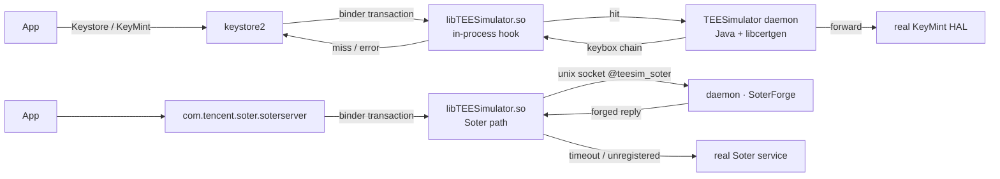

<!-- translated from README.md sha256:6d68553d15c9fc125ee046819d3191578b209c581d91cf3b9a17b68ebd160adb -->
<div align="center">

# TEESimulator-MapleSU

**一個可獨立運作的 Key Attestation 與 Soter 相容層，適用於已 root 的 Android 裝置。**

不需要 Zygisk · 不需要 LSPosed · 不依賴任何其他模組 · KernelSU / Magisk / APatch

[](../../releases)
[](../../actions)
[](docs/INSTALL.md)
[](docs/INSTALL.md)
[](LICENSE)

[English](README.md) · [简体中文](README.zh-CN.md) · **繁體中文** · [日本語](README.ja.md) · [Русский](README.ru.md)

[安裝](docs/INSTALL.md) · [建置](docs/BUILD.md) · [設定](docs/CONFIG.md) · [架構](docs/ARCHITECTURE.md) · [FAQ](docs/FAQ.md)

</div>

---

## 這是什麼

已 root 的 Android 手機通常會在兩個地方露出破綻：一是**基於硬體的 Key Attestation**，應用程式要求裝置證明自己的 TEE 是真的；二是 **Soter**，應用程式要求系統確認某個金鑰或生物辨識操作來自受信任的環境。

*TEESimulator-MapleSU* 讓這兩種互動重新回到前後一致的狀態，同時不會取代系統中原本就能正常運作的部分：

- 對於 Key Attestation 請求，keystore2 會以**你**提供的 keybox 所建立的憑證鏈回應；
- 對於 Soter，13 個 AIDL 交易會依照真實裝置的語意回應，包括每個 uid 一把 ASK、依 (uid, alias) 區分的 AuthKey 註冊紀錄、計數器、一次性工作階段與標準錯誤代碼，並以原廠 TA 採用的 **RSA-PSS** 方案簽章；
- 其他一切都**轉送給系統的真實實作**。

本專案是 [TEESimulator-RS](https://github.com/Enginex0/TEESimulator-RS) 的分支（TEESimulator-RS 本身以 [JingMatrix/TEESimulator](https://github.com/JingMatrix/TEESimulator) 為基礎）。上游證明了在交易層攔截是行得通的；本分支則把它發展成更完整、更能適應不同執行環境的實作。

> 我們在開發用的裝置上，針對 **Duck Detector、春秋與 Demo 1.7** 的公開檢查項目進行回歸測試。先前回報「裝置 TEE 不可信」的項目（憑證鏈產生、開機狀態、Soter 可用性）之後都能如預期運作。這不代表對任何商業風險控管機制的承諾；請參閱[免責聲明](#免責聲明)。

---

## 本分支新增了什麼

| | 上游 TEESimulator-RS | 本專案 |
|---|---|---|
| 相依性 | 注入的函式庫 | **只需要 root：不需要 Zygisk、LSPosed 或輔助模組** |
| Soter | 基本偽造（固定金鑰、沒有工作階段） | **每個 uid 一把 ASK、每個 (uid, alias) 一把 AuthKey、計數器、具 TTL 的一次性工作階段、標準錯誤代碼** |
| 簽章 | PKCS#1 v1.5 | **RSASSA-PSS（SHA-256 / MGF1 / salt 20 / emBits 2047）** |
| 控制通道 | 只有 binder 註冊 | **優先使用 binder，其次是行程內的 unix socket（`@teesim_soter`）**，註冊不再依賴 AMS |
| WebUI | 部分 | **雙後端**：原生 `.so` HTTP 或 `ksu.exec` |
| 可靠性 | 基本 | 有時限的注入探測、單一執行個體防護、舊 id 遷移、開機後重新整理 target |
| 可觀察性 | 記錄檔 | **`ksu_status` 記錄開機的每個步驟** |

---

## 運作原理



只有一條原則：**盡量少改，其餘全部轉送**。每一條失敗路徑都會退回真實的實作，所以模擬出問題時，最多讓某項功能失去作用，不會讓裝置的 keystore 停擺。

有三項設計決策比其他的更重要：

1. **金鑰依身分區分。** ASK 依 uid 產生並永久保存；AuthKey 依 (uid, alias) 產生。這和真實裝置一致，真實裝置上每個應用程式都有自己的 ASK；同時也避免了共用單一金鑰對所留下的指紋特徵。
2. **註冊不能依賴 AMS。** 單獨執行的 `app_process` 沒有行程紀錄，因此 `bindService` 會遭到拒絕。注入的函式庫在 saterserver 內監聽一個抽象 unix socket，再由常駐程式連線過去，讓整條路徑完全不經過 AMS。
3. **失敗就轉送。** socket 逾時兩秒、未註冊的代碼，或是 `-1` 回覆，都會把交易交還給真實的服務。

---

## 功能

| 項目 | 說明 |
|---|---|
| Key Attestation | 攔截 keystore2 的金鑰與證明交易，以 keybox 建立完整的憑證鏈 |
| 依應用程式接管 | `target.txt`；`pkg`、`pkg!`、`!pkg`、`pkg?` 與 `?pkg` 寫法都支援 |
| Soter | 13 個交易、註冊紀錄、工作階段、錯誤代碼、PSS 簽章 |
| Soter 接管範圍 | 依應用程式設定的白名單，可在 WebUI 中編輯 |
| 憑證鏈 | 預設關閉；啟用後，Soter blob 會附帶 keybox 憑證鏈 |
| 憑證自動更新 | 預設開啟，以原子方式替換；更新失敗時絕不覆寫使用中的檔案，並在五分鐘後重試；你自己放置的 keybox 只有**立即更新**會替換，替換前會先備份 |
| 系統偽裝 | bootloader 狀態與安全性修補程式日期 |
| 相容性檢查 | 安裝時執行，結果輸出到安裝記錄檔，絕不會阻擋安裝；其他模組依其實際變更的內容判斷，而不是看名稱 |
| WebUI | 版本、相容性檢查、SOTER、憑證、keybox、偽裝、接管範圍；春、夏、秋、冬四套楓葉季節主題，各有淺色與深色；中英文介面文字來自語言套件 |
| 可觀察性 | `ksu_status` 記錄開機的每個步驟 |

---

## 系統需求

- Android 10 以上（開發與回歸測試涵蓋至 Android 17）
- 64 位元裝置（arm64-v8a）
- Root：KernelSU、Magisk 或 APatch
- 一份 `keybox.xml`，**來源必須是你依法可以使用的**；本儲存庫不附帶任何金鑰材料

---

## 安裝

1. 從 [Releases](../../releases) 下載 zip。
2. 用你的 root 管理器安裝，然後重新啟動。
3. 放入你的 keybox：

   ```bash
   su -c 'cp /sdcard/Download/keybox.xml /data/adb/tricky_store/keybox.xml'
   su -c 'chmod 644 /data/adb/tricky_store/keybox.xml'
   ```

4. 重新啟動後查看 WebUI。沒有 keybox 時，攔截器不會做任何事；設定有誤的模組只會失去作用，不會造成危害。

模組 id 是 `tricky_store`，與上游相同，因此可以直接取代既有的安裝；從舊 id `teesimulator-rs` 升級時會自動遷移。升級、解除安裝與回復舊版請見 [docs/INSTALL.md](docs/INSTALL.md)。

---

## 設定

所有檔案都在 `/data/adb/tricky_store/` 底下。

| 檔案 | 用途 |
|---|---|
| `keybox.xml` | 憑證鏈來源（你自己的） |
| `keybox_update.conf` | 自動更新：開關、來源、間隔、重試狀態 |
| `target.txt` | 哪些應用程式會被接管 |
| `security_patch.txt` | 跟隨裝置或固定日期 |
| `soter_scope.conf` | Soter 接管範圍（檔案不存在 = 所有應用程式） |
| `soter_certs` | 憑證鏈開關（預設關閉） |
| `soter_socket_off` | 停用 socket 通道，退回 binder |
| `ksu_status` | 開機各步驟的結果 |

各欄位的說明請見 [docs/CONFIG.md](docs/CONFIG.md)。

---

## 驗證

```bash
# module state
su -c 'cat /data/adb/tricky_store/ksu_status'

# did the injection actually land?
su -c 'pid=$(pidof keystore2); grep -c libTEESimulator /proc/$pid/maps'

# which Soter channel is in use?
su -c 'cat /data/adb/tricky_store/soter_route'
```

| 值 | 意義 |
|---|---|
| `core=ok` / `daemon=<pid>` | 常駐程式正在執行 |
| `inject=ok` | 注入成功並已確認 |
| `soter_route=socket` | Soter 使用不依賴 AMS 的通道 |
| `conflict=<id>` | 偵測到另一個 TEE 模組，本模組主動退讓 |

公開偵測項目的回歸測試紀錄請見 [docs/FAQ.md](docs/FAQ.md#检测项)。

---

## 從原始碼建置

```bash
# JDK 21 + Android NDK r26 + Python 3.11+
cd dex && python3 make_p16.py a b d e f g s s4 m p        # -> classes_p16.dex
cd ../native && "$ANDROID_NDK/ndk-build" NDK_PROJECT_PATH=. # -> libTEESimulator.so
MAPLESU_TEE_DEX=dex/classes_p16.dex python3 tools/package_teesimulator_bundle.py
```

建置結果可以重現：以相同的原始碼建置兩次，會得到完全相同的雜湊值。請見 [docs/BUILD.md](docs/BUILD.md)。

---

## 專案結構

| 路徑 | 內容 |
|---|---|
| `dex/` | smali 修補樹與 Java 原始碼（`mpl/*`）：交易處理與憑證產生 |
| `native/` | `libTEESimulator.so`：binder hook 與 Soter socket 通道 |
| `module/` | `hide_bootloader.sh`、`core/webui.sh`、`core/compat.sh`、`webroot/`、`sepolicy.rule` |
| `tools/` | 封裝、驗證與診斷用的指令碼 |
| `docs/` | 安裝、建置、設定、架構、FAQ |
| `scripts/` | 建置進入點 |

---

## 文件

| 文件 | 內容 |
|---|---|
| [INSTALL](docs/INSTALL.md) | 安裝、升級、解除安裝、回復舊版、安裝時的常見問題 |
| [BUILD](docs/BUILD.md) | dex、原生函式庫、封裝、驗證 |
| [CONFIG](docs/CONFIG.md) | 所有設定欄位 |
| [ARCHITECTURE](docs/ARCHITECTURE.md) | 攔截路徑、socket 通訊協定、憑證產生 |
| [FAQ](docs/FAQ.md) | 疑難排解與偵測工具說明 |
| [TRANSLATING](docs/TRANSLATING.md) | 翻譯 WebUI 與 README |

---

## 致謝

- 上游：[Enginex0/TEESimulator-RS](https://github.com/Enginex0/TEESimulator-RS) 與 [JingMatrix/TEESimulator](https://github.com/JingMatrix/TEESimulator)，兩者皆採用 GPL-3.0。
- 特別感謝 **[知秋 (947409161)](https://github.com/947409161)** 在 Soter 語意、偵測項目回歸測試與除錯方向上的協助。
- 相關的參考實作：它們公開的設計是我們設計時的參考；沒有重複使用任何程式碼。

完整名單請見 [CREDITS.md](CREDITS.md)。

## 授權條款

GPL-3.0。上游的著作權屬於 Enginex0 與 JingMatrix；請見 [NOTICE](NOTICE)。

## 免責聲明

本專案是 Android Key Attestation 與 Soter **介面相容性**的研究實作，目的是研究系統安全機制在你自己擁有的裝置上如何運作。

- 本專案**不針對任何特定應用程式**，不含針對特定應用程式的調整，也不提供任何形式的身分驗證或授權繞過；
- 本專案**不附帶任何金鑰材料**；你必須自行提供可合法使用的憑證來源；
- **禁止**在未經授權的裝置上使用，或用於詐欺及任何違法用途；
- 在部分司法管轄區，修改裝置的安全機制可能違反當地法律或服務條款；你必須自行負責遵守相關規定；
- 對於因使用而造成的帳號風險控管、裝置故障、資料遺失或法律後果，作者概不負責。

依 GPL-3.0 授權散布，不提供任何形式的擔保。
